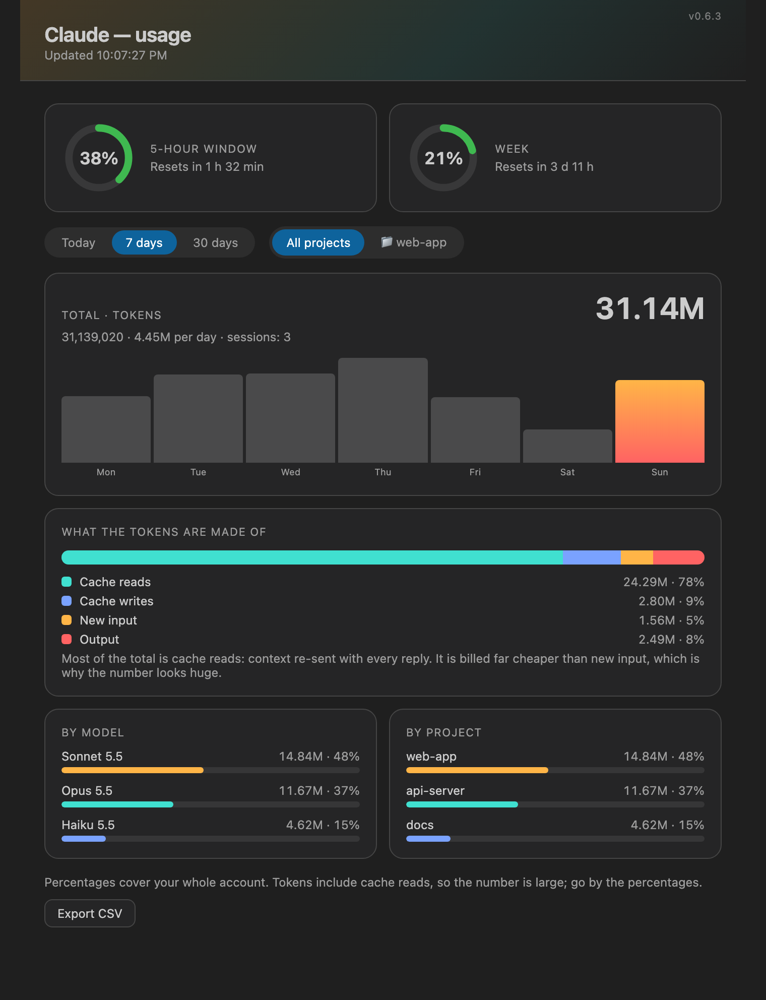
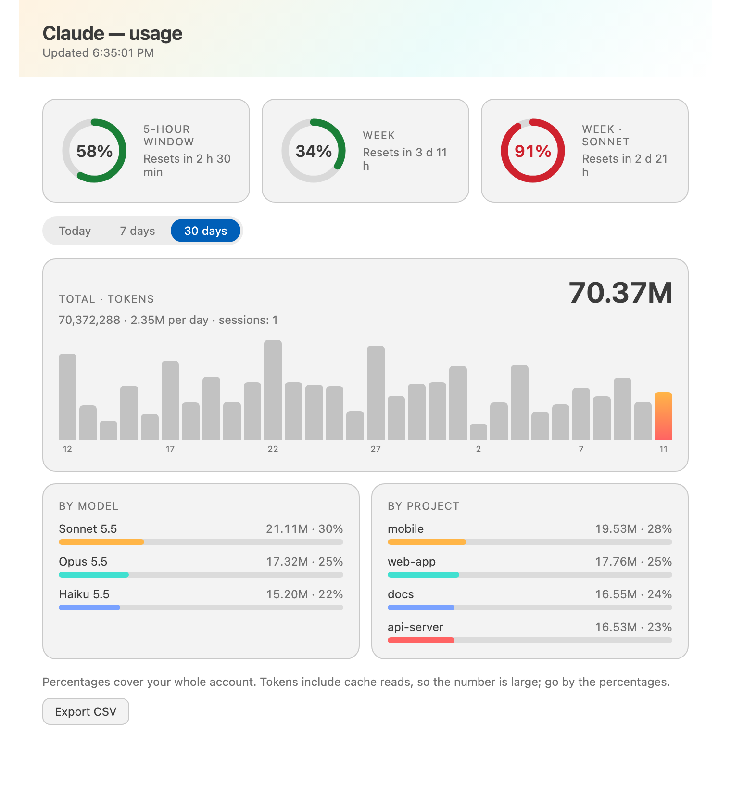

<p align="center"></p>

<h1 align="center">Claude Usage Monitor</h1>

<p align="center">
Your Claude Code <b>5-hour</b> and <b>weekly</b> limits, tokens by <b>day, model and project</b>,<br>
alerts and a pace forecast — right in the status bar of VS Code, Antigravity and Cursor.
</p>

<p align="center">
<a href="https://open-vsx.org/extension/andreykilanov/claude-usage-monitor"></a>
<a href="https://open-vsx.org/extension/andreykilanov/claude-usage-monitor"></a>
<a href="LICENSE"></a>
</p>

<p align="center"><a href="#русская-версия">Русская версия ↓</a></p>

<p align="center"></p>
<p align="center"><sub>Sample data. The panel follows your editor theme.</sub></p>

> **Unofficial.** Not affiliated with or endorsed by Anthropic. "Claude" is a trademark of its owner; it is used here only to say what the tool works with.

## What you get

| | |
| --- | --- |
| **Status bar** | `5h 38% · wk 5% · today 1.2M`; turns yellow / red at 80% / 90% (configurable) |
| **Hover** | progress bars, time to reset, Sonnet / Opus weekly windows when your plan has them |
| **Menu** (click) | panel, copy a one-line summary, export CSV, refresh, settings, install / update the plugin, help |
| **Panel** | an *All projects / this project* switch, ring gauges, 24-hour / 7-day / 30-day charts, **what the tokens are made of** (cache reads / writes, new input, output), breakdown by model and by project |
| **Alerts** | a notification when a limit crosses the warning / critical percent, and when it resets |
| **Forecast** | "at this pace the 5-hour limit runs out in 23 min" — only when it would happen before the reset |
| **All sessions** | every window and session on the machine is added up, so "today" is the real total |
| **Many devices** | optional shared folder (iCloud Drive, Dropbox, Syncthing…) adds up your other machines |
| **CSV export** | by day and model, by day and project, or raw rows; opens cleanly in Excel / Numbers |
| **Languages** | Russian and English, picked from the editor language |

<p align="center"></p>

## How it works

Two small parts that talk through plain files on your disk:

```
Claude Code ── plugin/ (usage-monitor) ──▶ ~/.claude/usage-monitor/<session>.json ──▶ extension/ ──▶ status bar + panel
```

- **plugin/** is a Claude Code plugin. After each reply it writes the limits Claude Code already knows (5-hour, weekly, per-model) and the tokens spent into one file per session. It also draws a small band above the prompt in the terminal and the desktop app.
- **extension/** is the editor extension. It reads those files and shows them.

Why two parts: the Claude panel inside VS Code-style editors cannot draw custom UI, so the numbers are handed to a normal status-bar item.

**Nothing leaves your computer.** No network calls, no sign-in, no tokens or keychain access. The extension only reads the files above. If you turn on the optional sync folder, it copies those same files there — they contain token counts and the names of your project folders.

## Install

### 1. The plugin (every machine)

**Easiest:** install the extension first, then click the `Claude: no data` item in the status bar (or run **Claude Usage: Install the plugin** from the Command Palette). It finds Claude Code on your machine and, after you confirm, installs the plugin for you.

Or by hand, in a Claude Code terminal session:

```
/plugin install usage-monitor --marketplace AndreyKilanov/claude-usage-monitor
```

Answer `y` to add the marketplace, then pick the user scope.

### 2. The extension

- **Open VSX** (Antigravity, VSCodium, Cursor…): search **Claude Usage Monitor** in the Extensions view, or open the [listing](https://open-vsx.org/extension/andreykilanov/claude-usage-monitor).
- **From a file:** download `claude-usage-monitor-<version>.vsix` from [Releases](https://github.com/AndreyKilanov/claude-usage-monitor/releases), then Extensions → **⋯** → *Install from VSIX…*.

### 3. Start a new Claude session

Send any message. The numbers appear after the first reply (sessions started before the plugin was installed are not counted).

## Settings

| Setting | Default | What it does |
| --- | --- | --- |
| `claudeUsage.language` | `auto` | `auto`, `en` or `ru` |
| `claudeUsage.clickAction` | `menu` | what a click on the status bar item does: `menu` or `panel` |
| `claudeUsage.showFiveHour` / `showWeek` / `showToday` | `true` | choose what the status bar shows |
| `claudeUsage.showResetTimer` | `false` | time to reset next to the 5-hour percentage |
| `claudeUsage.warnAt` / `critAt` | `80` / `90` | yellow and red thresholds |
| `claudeUsage.notifications` | `true` | notify when a threshold is crossed |
| `claudeUsage.notifyOnReset` | `true` | notify when a limit that was high resets |
| `claudeUsage.syncFolder` | empty | shared folder to add up several devices |
| `claudeUsage.csvDelimiter` | `auto` | `auto` (`;` for Russian, `,` otherwise), `,`, `;` or `tab` |
| `claudeUsage.numberGrouping` | `auto` | `13 240 843` (`auto` follows the language: space for Russian, comma for English), `space`, `dot`, `comma` or `none` |
| `claudeUsage.refreshIntervalSeconds` | `30` | how often the bar redraws (files are also watched every 3 s) |

Commands (Command Palette): **Claude Usage: Open Panel**, **Refresh**, **Export CSV**.

## Good to know

- **Percentages are account-wide**, the same on every device. **Tokens are counted per machine** unless you set a sync folder.
- Token counts include cache reads, so the numbers are large. Go by the percentages for how much of your limit is left.
- Sonnet / Opus weekly windows and the 5-hour window only appear if your plan reports them.
- Needs a Claude subscription that reports usage windows. On other setups the percentages show "—" and tokens still count.
- Developed and tested on macOS. Windows is supported (home folder from `USERPROFILE`) but only covered by automated tests, not by daily use; Linux is untested. Please [open an issue](https://github.com/AndreyKilanov/claude-usage-monitor/issues) if something is off.

## Troubleshooting: the status bar says "no data"

Hover it — the tooltip says which case you are in and which folder it checks (`~/.claude/usage-monitor/`).

1. **Folder not found:** the plugin is not installed *on this machine*. Click the status bar item to install it (or see above) and start a new Claude session.
2. **Folder exists but is empty:** send a message in a **new** session. Sessions started before the plugin was installed or updated are not counted.
3. **Remote / WSL / SSH windows:** the extension and the plugin must run on the same machine and read the same home folder.
4. **Still nothing:** run `/plugin` in Claude Code and check that `usage-monitor` is enabled.

**The panel says "Not split (older data)" for everything.** The token split is recorded by plugin 0.6 and newer, and only for replies sent after the update. Click the status bar item → *Install the usage-monitor plugin* to update it, then start a **new** Claude session; the share of unsplit tokens shrinks as new replies arrive. The panel warns you when the plugin on that computer is still an old version.

The tooltip also shows the plugin's own note (`diagnostics.txt` in the plugin folder): `loaded` means the plugin runs, `error` carries the failing path and the system message. If it says the plugin left no note, the plugin is not running on that machine.

## Build from source

```bash
git clone https://github.com/AndreyKilanov/claude-usage-monitor
cd claude-usage-monitor
./scripts/build-vsix.sh        # writes dist/claude-usage-monitor-<version>.vsix
claude plugin validate plugin   # plugin checks
claude plugin test plugin       # plugin tests
node --test extension/test/extension.test.js   # extension tests
```

No dependencies and no build step: the extension is a single JavaScript file.

## License

[MIT](LICENSE) © Andrey Kilanov

---

# Русская версия

<p align="center"><b>Claude Usage Monitor</b> показывает лимиты Claude Code — на <b>5 часов</b> и на <b>неделю</b> — и расход токенов по <b>дням, моделям и проектам</b>. Предупреждает, когда лимит на исходе, и прикидывает, насколько его хватит. Всё это в строке состояния VS Code, Antigravity и Cursor.</p>

> **Неофициальный проект.** Он не связан с Anthropic и не одобрен ею. Название «Claude» принадлежит правообладателю и указано лишь затем, чтобы было понятно, с чем работает инструмент.

## Что умеет

| | |
| --- | --- |
| **Строка состояния** | `5ч 38% · нед 5% · сегодня 1.2M`. При 80% становится жёлтой, при 90% красной (пороги настраиваются) |
| **Подсказка** | шкалы лимитов, время до сброса, недельные лимиты Sonnet и Opus, если они есть в вашем тарифе |
| **Меню** (по клику) | панель, копирование краткой сводки, экспорт в CSV, обновление, настройки, установка и обновление плагина, справка |
| **Панель** | переключатель «Все проекты / этот проект», кольца лимитов, графики за сутки, 7 и 30 дней, **состав токенов** (чтение и запись кэша, новый запрос, ответ), расход по моделям и по проектам |
| **Оповещения** | уведомление, когда лимит достигает порога, и когда он сбрасывается |
| **Прогноз** | «при таком темпе 5-часовой лимит закончится через 23 мин». Показывается, только если лимит кончится раньше сброса |
| **Все сессии** | токены из всех окон и сессий на компьютере складываются, так что «сегодня» — это настоящий итог за день |
| **Несколько устройств** | по желанию можно указать общую папку (iCloud Drive, Dropbox, Syncthing…): тогда суммируются все ваши компьютеры |
| **Экспорт в CSV** | по дням и моделям, по дням и проектам или «сырые» строки. Файл нормально открывается в Excel и Numbers |
| **Языки** | русский и английский, выбираются по языку редактора |

## Как это устроено

Проект состоит из двух небольших частей, которые обмениваются обычными файлами на вашем диске:

- **plugin/** — плагин для Claude Code. После каждого ответа он сохраняет лимиты, которые Claude Code и так знает, и число потраченных токенов (по одному файлу на сессию). Ещё он рисует тонкую полоску над полем ввода в терминале и в приложении Claude для компьютера.
- **extension/** — расширение для редактора. Оно читает эти файлы и показывает их.

Частей две, потому что панель Claude внутри редакторов на базе VS Code не умеет показывать чужие элементы интерфейса. Поэтому плагин передаёт цифры расширению, а то выводит их в обычной строке состояния.

**Данные не покидают компьютер.** Расширение не обращается в сеть, не просит войти в аккаунт и не трогает ключи и пароли. Если вы включите папку синхронизации, расширение скопирует в неё те же файлы, а в них записаны количество токенов и названия папок ваших проектов.

## Установка

1. **Плагин** нужно поставить на каждом компьютере. **Самый простой способ:** сначала установите расширение, затем нажмите на `Claude: нет данных` в строке состояния (или выберите команду **Claude Usage: Install the plugin** в палитре команд). Расширение само найдёт Claude Code, покажет, что собирается выполнить, и после вашего согласия установит плагин. Можно и вручную, в терминальной сессии Claude Code:

   ```
   /plugin install usage-monitor --marketplace AndreyKilanov/claude-usage-monitor
   ```

   На вопрос о каталоге ответьте `y`, а затем выберите установку для пользователя (user scope).

2. **Расширение:** найдите **Claude Usage Monitor** в Open VSX ([страница расширения](https://open-vsx.org/extension/andreykilanov/claude-usage-monitor); работает в Antigravity, VSCodium, Cursor) или скачайте файл `.vsix` в разделе [Releases](https://github.com/AndreyKilanov/claude-usage-monitor/releases) и установите его: Extensions → **⋯** → *Install from VSIX…*.

3. **Начните новую сессию Claude** и отправьте любое сообщение. Цифры появятся после первого ответа. Сессии, начатые до установки плагина, не учитываются.

## Что важно знать

- **Проценты лимитов относятся ко всему аккаунту**, поэтому на всех устройствах они одинаковые. **Токены считаются отдельно на каждом компьютере**, пока вы не задали папку синхронизации.
- В число токенов входит чтение кэша, и поэтому оно получается очень большим. Сколько осталось до лимита, лучше судить по процентам.
- Недельные лимиты Sonnet и Opus появляются только в том случае, если их сообщает ваш тариф.
- Проект разрабатывался и проверялся на macOS. Windows поддерживается (домашняя папка определяется по `USERPROFILE`), но проверена в основном автотестами. Linux не проверялся. Если что-то работает неправильно, [создайте обращение](https://github.com/AndreyKilanov/claude-usage-monitor/issues).

## Если в строке состояния «нет данных»

Наведите на неё курсор. В подсказке написано, в чём причина, и указана папка, где расширение ищет данные (`~/.claude/usage-monitor/`).

1. **Папки с данными нет.** Плагин не установлен *на этом компьютере*. Нажмите на элемент в строке состояния, чтобы установить его (или воспользуйтесь инструкцией выше), и начните новую сессию Claude.
2. **Папка есть, но пуста.** Отправьте сообщение в **новой** сессии. Сессии, начатые до установки или обновления плагина, не учитываются.
3. **Удалённые окна (WSL, SSH).** Расширение и плагин должны работать на одном компьютере и читать одну и ту же домашнюю папку.
4. **Ничего не помогло.** Выполните `/plugin` в Claude Code и проверьте, что `usage-monitor` включён.

**В панели вся разбивка «Без разбивки (старые записи)».** Состав токенов записывает плагин версии 0.6 и новее, и только для ответов, отправленных после обновления. Нажмите на элемент в строке состояния → «Установить плагин usage-monitor», затем начните **новую** сессию Claude: доля токенов без разбивки будет уменьшаться по мере новых ответов. Если плагин на этом компьютере всё ещё старой версии, панель предупредит об этом.

В подсказке также показывается сообщение самого плагина (файл `diagnostics.txt` в его папке). Слово `loaded` означает, что плагин запущен, а `error` — что произошла ошибка, и рядом будут путь и текст системной ошибки. Если сказано, что плагин ничего не сообщил, значит, на этом компьютере он не работает.
